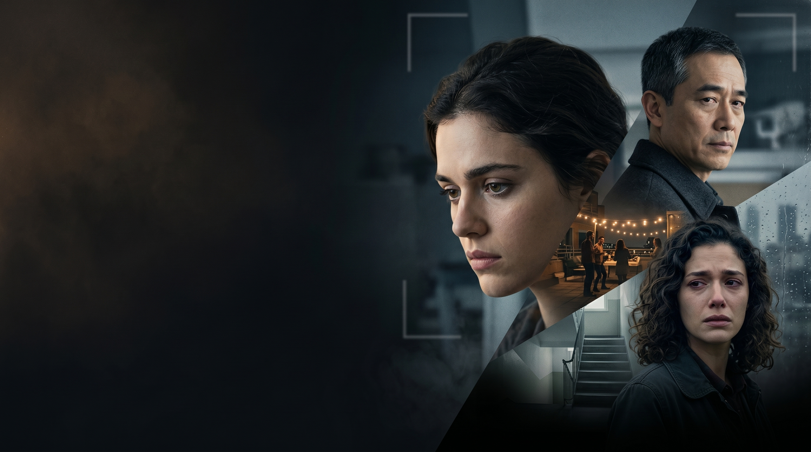

<p align="center">
  
</p>

<h1 align="center">The Missing Angle</h1>

<p align="center">
  <strong>An interactive murder mystery you investigate with your voice.</strong><br/>
  Watch CCTV. Collect evidence on a 3D rooftop. <strong>Interrogate three suspects live with ElevenLabs Speech Engine.</strong><br/>
  Name the killer — or accuse the wrong person and let Adrian Cole walk free.
</p>

<p align="center">
  <strong>🎙 Built with <a href="https://elevenlabs.io/docs/speech-engine">ElevenLabs Speech Engine</a></strong> — real-time voice interrogations powered by WebRTC, STT, TTS, and our Groq LLM logic
</p>

<p align="center">
  <a href="https://the-missing-angle.vercel.app"><strong>▶ Play the demo</strong></a>
  &nbsp;·&nbsp;
  <a href="https://hacks.elevenlabs.io/hackathons/9">ElevenLabs Hack #10: Speech Engine</a>
</p>

---

## The pitch

Daniel Reed died on a rooftop after a party. CCTV shows Maya and Sara leaving him alive. The camera feed cuts. Someone pushed him.

You are the detective. The case is not solved in a cutscene — **you ask the questions**, **you connect the clues**, and **you decide who to accuse**. The twist is not just whodunit: the missing camera angle is the whole case.

Built for **[ElevenLabs Hack #10: Speech Engine](https://hacks.elevenlabs.io/hackathons/9)**.

**Speech Engine is the core mechanic of this project.** During witness interviews, the player opens a live video call and speaks to Sara, Maya, or Adrian Cole out loud. ElevenLabs Speech Engine handles the full voice loop — microphone capture, speech-to-text, text-to-speech, turn-taking, and interruption detection — while our FastAPI server supplies the character brain via Groq. You are not picking lines from a menu; you are running a real interrogation.

---

## ElevenLabs Speech Engine — how we use it

This project is a **voice-native interactive experience** built around Speech Engine, not a text game with optional voice.

### What Speech Engine does (ElevenLabs)

| Capability | Handled by |
|------------|------------|
| Browser mic access & WebRTC session | ElevenLabs Speech Engine + `@11labs/client` SDK |
| Speech-to-text on each player utterance | ElevenLabs (inside Speech Engine) |
| Text-to-speech for suspect replies | ElevenLabs TTS (per-character voice) |
| Turn-taking & barge-in / interruption | ElevenLabs Speech Engine SDK |

### What we provide (our server)

| Capability | Handled by |
|------------|------------|
| Character personality, cover story, pressure rules | Groq `llama-3.3-70b` system prompts in `sara_engine.py` |
| Streaming in-character replies | `SpeechEngineServer` + `on_transcript` handler |
| Three separate agents | One Speech Engine resource each: **Sara**, **Maya**, **Cole** |
| WebSocket endpoints | `/ws/sara`, `/ws/maya`, `/ws/cole` in `server.py` |
| Session tokens for the browser | `GET /api/speech-engine/token` |

### End-to-end flow

```
Player clicks "Start live conversation" in an interview
    ↓
Browser fetches WebRTC token  →  GET /api/speech-engine/token?character=SARA
    ↓
ElevenLabs @11labs/client starts Speech Engine session (WebRTC)
    ↓
Player speaks  →  ElevenLabs STT  →  transcript sent to our WebSocket
    ↓
FastAPI /ws/sara  →  Groq streams character reply  →  ElevenLabs TTS  →  player hears suspect
    ↓
Repeat until player ends session or moves to next witness
```

### Setup in this repo

1. **`setup_speech_engines.py`** — registers three Speech Engine resources in ElevenLabs, each pointing `ws_url` at our public `/ws/{character}` endpoint and binding a distinct ElevenLabs voice per suspect.
2. **`sara_engine.py`** — three `SpeechEngineServer` instances (Sara / Maya / Cole), each with its own Groq system prompt (nervous witness, grieving girlfriend, defensive security supervisor).
3. **`frontend/detective-room.js`** — loads the ElevenLabs browser SDK, requests a token, and calls `Conversation.startSession()` during each video-call interrogation.

Without Speech Engine, the mystery still plays (hint questions + TTS via HTTP), but **the live voice interrogation — the hackathon centerpiece — does not run.**

Docs: [Speech Engine overview](https://elevenlabs.io/docs/speech-engine) · [Speech Engine cookbook](https://elevenlabs.io/docs/cookbooks/speech-engine)

---

## Why Speech Engine for a murder mystery

Most mystery games give you dialogue trees. **The Missing Angle gives you witnesses you can talk to.**

Each suspect runs on **ElevenLabs Speech Engine** with **Groq** as the brain:

| Layer | Who handles it |
|-------|----------------|
| Microphone → text | ElevenLabs STT (via Speech Engine) |
| Character logic | Groq `llama-3.3-70b` with per-character prompts, cover stories, and pressure rules |
| Text → voice | ElevenLabs TTS (each suspect’s own voice) |
| Turn-taking & interruption | ElevenLabs Speech Engine SDK |

You speak naturally. The suspect hears you, thinks in character, and responds aloud — nervous, defensive, evasive. No script to pick from. No chat box. Just an interrogation.

```
Browser mic
    ↓
ElevenLabs Speech Engine (WebRTC)
    ↓  transcript
FastAPI  /ws/sara  |  /ws/maya  |  /ws/cole
    ↓  Groq streaming reply
ElevenLabs TTS  →  browser speaker
```

Beyond Speech Engine, the project also uses **ElevenLabs TTS** for narration and scripted lines, **ElevenLabs STT** (`scribe_v2`) for spoken accusations, and the **ElevenLabs Music API** for scene beds.

---

## Player flow

1. **Opening** — Narrated rooftop party; the case file drops you into the investigation.
2. **3D rooftop search** — Walk the splat scene, collect three physical clues (recorder, SD card, transmitter log).
3. **CCTV review** — Fragmented footage sets up the timeline.
4. **Live interviews (Speech Engine)** — Video-call Sara → Maya → Cole. Tap quick questions *or* click **Start live conversation** to interrogate each suspect with **ElevenLabs Speech Engine** (WebRTC voice in, Groq logic, voice out).
5. **Evidence whiteboard** — Replay recovered audio, sync clues to suspects, read Groq-generated interview insights.
6. **Accusation** — Accuse Sara, Maya, or Cole. Multiple endings; only one closes the case.

Wrong accusation endings are intentional — the game punishes reading motive without reading the camera log.

---

## ElevenLabs features used

| Feature | Use in this project |
|---------|---------------------|
| **Speech Engine** ⭐ | **Primary hackathon feature** — live WebRTC interrogations with Sara, Maya, and Cole; three agents, three voices, Groq-powered replies |
| **Text-to-Speech** | Narrator, scripted hint answers, recovered audio fragments, trailer |
| **Speech-to-Text** | Spoken final accusation (`scribe_v2`) |
| **Music API** | Cinematic scene beds (`intro_party`, interviews, CCTV, ending) |
| **Conversational AI / WebRTC token** | `GET /api/speech-engine/token` bootstraps browser Speech Engine sessions |

---

## Quick start

### Prerequisites

- Python 3.9+
- [ElevenLabs API key](https://elevenlabs.io/app/settings/api-keys)
- [Groq API key](https://console.groq.com/) (for live suspect replies)

### Run locally

```bash
git clone <your-repo-url>
cd speechengine
python3 -m pip install -r requirements.txt
cp .env.example .env
# Add ELEVENLABS_API_KEY and GROQ_API_KEY to .env
python3 -m uvicorn server:app --host 127.0.0.1 --port 8000
```

Open **http://127.0.0.1:8000**.

Or use the helper script:

```bash
./run.sh
```

### Live interviews (Speech Engine)

Speech Engine needs a **public WebSocket** endpoint. Vercel serves the scripted game over HTTP; live voice runs on a persistent backend (Railway, Render, or ngrok for local dev).

1. Deploy `server.py` to a WebSocket-capable host, **or** run locally with ngrok:

   ```bash
   ngrok http 8000
   ```

2. Set in `.env`:

   ```bash
   SPEECH_ENGINE_PUBLIC_URL=https://your-public-url.example.com
   ```

3. Register Speech Engine resources (one-time):

   ```bash
   python3 setup_speech_engines.py
   ```

4. Add the printed IDs to `.env`:

   ```bash
   SARA_SPEECH_ENGINE_ID=seng_...
   MAYA_SPEECH_ENGINE_ID=seng_...
   COLE_SPEECH_ENGINE_ID=seng_...
   ```

5. Restart the server. In an interview, click **Start live conversation** and speak to the suspect.

---

## Deploy

### Recommended: Railway (faster video + Speech Engine)

**Use Railway for the full experience.** Vercel runs `server.py` as a serverless function — large MP4s (intro, CCTV, trailer) buffer slowly and WebSockets are unavailable. Railway runs one persistent Uvicorn process with direct static file streaming and range requests.

1. Go to [railway.app](https://railway.app) → **New Project** → **Deploy from GitHub repo** → select this repo.
2. Railway picks up [`railway.toml`](railway.toml) / [`nixpacks.toml`](nixpacks.toml) automatically.
3. Add environment variables (same as local):
   - `ELEVENLABS_API_KEY`
   - `GROQ_API_KEY`
   - After deploy, set `SPEECH_ENGINE_PUBLIC_URL` to your Railway public URL (e.g. `https://your-app.up.railway.app`)
   - Run `python3 setup_speech_engines.py` locally with that URL, then add `SARA_SPEECH_ENGINE_ID`, `MAYA_SPEECH_ENGINE_ID`, `COLE_SPEECH_ENGINE_ID` in Railway.
4. Open **Settings → Networking → Generate domain** and play at your `*.up.railway.app` URL.

Verify deploy: `GET /api/health` should return `"platform": "railway"`.

### Optional: Vercel (HTTP-only fallback)

1. Import the repo in [Vercel](https://vercel.com).
2. Set `ELEVENLABS_API_KEY` (and `GROQ_API_KEY` for whiteboard insights).
3. Deploy — **https://the-missing-angle.vercel.app**

On Vercel, WebSockets are unavailable and video loads through serverless — expect slower playback. The client auto-switches to `/api/game/*` HTTP mode on `*.vercel.app`.

---

## Environment variables

| Variable | Required | Purpose |
|----------|----------|---------|
| `ELEVENLABS_API_KEY` | Yes | TTS, STT, Speech Engine, Music API |
| `GROQ_API_KEY` | Recommended | Live suspect dialogue + whiteboard insights |
| `SPEECH_ENGINE_PUBLIC_URL` | For live voice | Public URL ElevenLabs calls for `/ws/*` |
| `SARA_SPEECH_ENGINE_ID` | For live voice | From `setup_speech_engines.py` |
| `MAYA_SPEECH_ENGINE_ID` | For live voice | From `setup_speech_engines.py` |
| `COLE_SPEECH_ENGINE_ID` | For live voice | From `setup_speech_engines.py` |
| `*_VOICE_ID` | Optional | Override default ElevenLabs voices |
| `ELEVENLABS_MUSIC_MODEL` | Optional | Default `music_v1`; set `music_v2` if your key supports it |

See [`.env.example`](.env.example) for the full list.

---

## Tech stack

| | |
|---|---|
| **Backend** | FastAPI, WebSockets, Groq |
| **Voice** | ElevenLabs Speech Engine, TTS, STT, Music API |
| **Frontend** | Vanilla JS SPA, Three.js + Spark (3D rooftop) |
| **Story** | JSON scene graph (`scenes.json`) + runtime state |
| **Deploy** | **Railway** (recommended — static streaming + WebSockets) · Vercel (HTTP fallback) |

---

## Project structure

```
speechengine/
├── server.py              # Game API, TTS/STT, Speech Engine WebSockets
├── sara_engine.py         # Groq handlers for Sara / Maya / Cole Speech Engine
├── story_engine.py        # Scene state machine
├── scenes.json            # Full story, questions, endings
├── media_engine.py        # ElevenLabs Music generation
├── setup_speech_engines.py
├── frontend/              # SPA shell, detective room UI
├── static/
│   ├── scenes/            # Video loops (interviews, CCTV, ending)
│   ├── music/             # Scene beds
│   ├── evidence/          # Clue art
│   └── rooftop-investigation.js
└── 3d/                    # Rooftop splat world (.spz)
```

Regenerate music beds:

```bash
python3 scripts/generate_music.py --only cole_video_call
```

---

## Hackathon submission

**Event:** [Hack #10: Speech Engine](https://hacks.elevenlabs.io/hackathons/9)  
**Tag on social:** `@elevenlabsio` · `#ElevenHacks`

**What we built:** A voice-native interactive film where **ElevenLabs Speech Engine** is the main interaction layer — three suspects you interrogate out loud over WebRTC, each with their own Speech Engine agent, ElevenLabs voice, and Groq-driven personality. ElevenLabs owns the voice pipeline (STT, TTS, turn-taking); we own the mystery logic (lies, deflections, cracks under pressure).

**Speech Engine in one sentence:** Talk to Sara, Maya, or Cole like a real detective; Speech Engine makes them answer back.

**Demo:** [the-missing-angle.vercel.app](https://the-missing-angle.vercel.app) *(live voice requires Speech Engine backend — see setup above)*

---

<p align="center">
  <em>Everyone remembers the fall. No one remembers the same moment.<br/>
  One frame was missed. One silence was kept.<br/>
  <strong>The Missing Angle.</strong></em>
</p>
